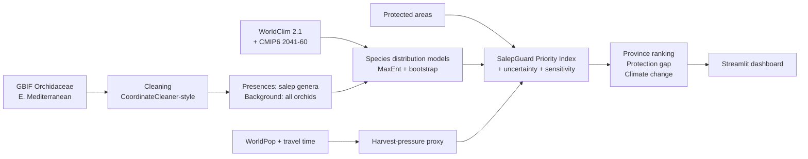
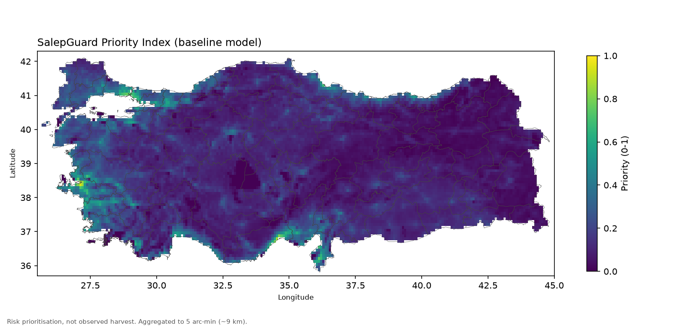
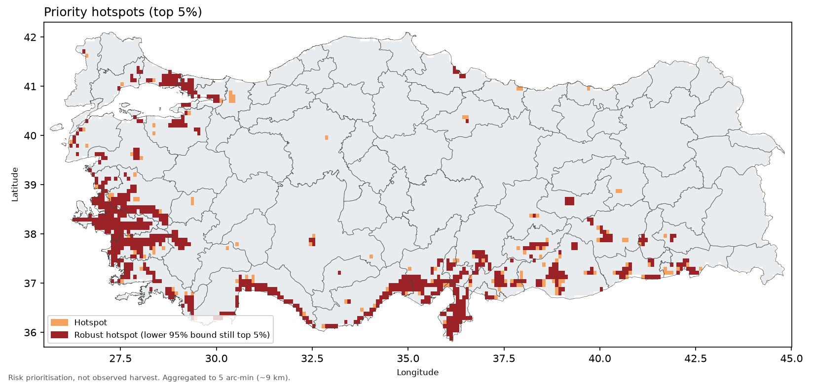
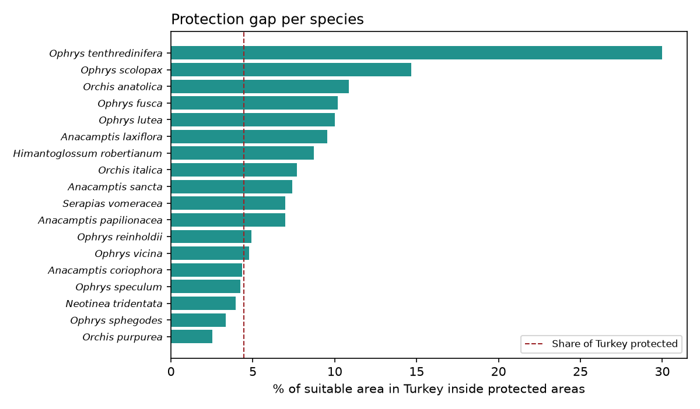

# SalepGuard

**Uncertainty-aware conservation prioritisation for Turkey's wild salep orchids.**
Where could salep orchids live, where is harvest pressure high, and which of those places lie outside
protected areas?

- **Live dashboard:** https://salepguard.streamlit.app
- **Pitch video:** https://youtu.be/XhjzKYrCOZ4
- **Slides (PDF):** [slides/salepguard_slides.pdf](slides/salepguard_slides.pdf)
- **Slides:** [`slides/`](slides/)
- **Team status / handoff:** [`docs/HANDOFF.md`](docs/HANDOFF.md)

> SalepGuard is a **risk-prioritisation tool**, not a map of observed harvest or of orchid locations.
> Maps are modelled, deliberately coarse (~9 km) and require field validation. Nothing here is clinical
> or definitive information.

## Track

EthnoHack 2026, **Track 3: Biodiversity & Sustainability**: geospatial and ecological data to map
medicinal-plant diversity, identify conservation risks and support sustainable harvesting.

## Problem

Salep is a flour made from the dried tubers of terrestrial orchids. It is used for the traditional hot
drink, *salepli dondurma* (salep ice cream) and in folk medicine. In Turkey, tubers of about 90 orchid
species in 24 genera have been reported in salep (Sezik 2002). Salep orchids are not cultivated
commercially, so the trade depends on wild collection, and **digging up a tuber kills the plant**. Several
decades of trade studies document large export volumes and declining populations (Kasparek & Grimm 1999).
Similar unsustainable tuber harvest is reported in Greece (Kreziou et al. 2016) and Iran (Ghorbani et al.
2014), and in Turkey orchids survive mainly where digging is culturally avoided, such as graveyards
(Molnár et al. 2017).

Conservation agencies need to know **where** to focus monitoring, enforcement and alternatives
(cultivation trials, certified supply). That needs species distributions, a measure of harvest pressure,
protected-area coverage, and honest uncertainty.

## Solution and approach



```
priority_i = Σ_species  suitability_s,i × pressure_i × (1 − protected_i)
```

Robust hotspots are cells that stay in the top 5 % even at the lower 95 % bound of the propagated model
uncertainty.

## Data sources

| Data | Provider | Version | Licence | DOI / citation |
|---|---|---|---|---|
| Orchidaceae occurrences | GBIF.org | download 0005388-261104105008071, 2026-11-07 | per record CC0 / CC BY / CC BY-NC | GBIF.org (7 November 2026) GBIF Occurrence Download https://doi.org/10.15468/dl.mfzrky |
| Bioclim + elevation | WorldClim 2.1, 2.5′ | 1970–2000 | academic / non-commercial; no redistribution | Fick & Hijmans 2017, doi:10.1002/joc.5086 |
| Future bioclim | WorldClim CMIP6 (MPI-ESM1-2-HR, IPSL-CM6A-LR, MIROC6) | SSP2-4.5, SSP5-8.5, 2041–2060 | as WorldClim | — |
| Population density | WorldPop, 1 km UN-adj. | 2020 | CC BY 4.0 | doi:10.5258/SOTON/WP00674 |
| Travel time to cities | Malaria Atlas Project | 2015 | CC BY 4.0 | Weiss et al. 2018, doi:10.1038/nature25181 |
| Protected areas | WDPA (Nov 2026 public release; only 17 Turkish sites public) ∪ OpenStreetMap | Nov 2026 / 2026-11-07 | WDPA ToU / ODbL | UNEP-WCMC & IUCN (2026) Protected Planet: WDPA, Nov 2026 |
| Province boundaries | geoBoundaries gbOpen TUR | 2023 build | CC BY-SA 2.0 | Runfola et al. 2020, doi:10.1371/journal.pone.0231866 |

You can find full details in [`docs/data_sources.md`](docs/data_sources.md) and in the auto-generated
[`data/processed/DATA_MANIFEST.md`](data/processed/DATA_MANIFEST.md).

## Methods (summary)

- **Grid:** WorldClim 2.5′ (≈4.6 km), EPSG:4326. Training extent is lon 19–45°, lat 34–43° (Eastern
  Mediterranean). Results are reported for Turkey only.
- **Occurrences:** one GBIF query for all Orchidaceae (62,435 records). Cleaning removes fossil and living
  specimens, records before 1970, coordinate uncertainty above 5 km, centroids, capitals, sea and
  duplicates. This leaves **24,557 salep-genus records of 108 species**. The **20 species** with ≥ 50 cells
  in the extent and ≥ 15 cells in Turkey are modelled. All-orchid records form a target-group background
  that corrects for sampling bias.
- **Models:** the final model is bias-corrected MaxEnt with spatial block CV and bootstrap (in
  [`modeling/`](modeling/), by Sena Aydın). There is also a Python MaxEnt **baseline** (`elapid`)
  with 5-fold CV and 10 bootstrap refits, used as fallback and robustness check.
- **Pressure:** `0.5 × log population + 0.5 × inverted log travel time`, each scaled 0–1. The pressure
  weights are tested at 0.7/0.3 and 0.3/0.7.
- **Index, uncertainty, sensitivity, climate change, province ranking, protection gap:** see
  [`docs/methods.md`](docs/methods.md).

## Results (final model, WDPA + OSM protected areas)

| | |
|---|---|
| Species modelled | 20 (6 genera: *Anacamptis, Ophrys, Orchis, Neotinea, Himantoglossum, Serapias*); 18 pass the quality rule and enter the index |
| Final model, spatial block CV (mean of 20 species) | AUC 0.72 (0.58–0.87), TSS 0.32, Boyce 0.58; all beat a bias-aware null model |
| Baseline CV performance (mean of 20 species) | AUC 0.79 (0.64–0.91), TSS 0.49, Boyce 0.85 |
| Share of Turkey protected (WDPA + OSM layer) | 4.5 % |
| Share of salep-orchid suitable area protected | **4.5 %**, no better than a random placement of protected areas |
| Median species: suitable area protected | 7.2 % |
| Top-5 provinces by mean priority | Hatay, İzmir, Aydın, İstanbul, Gaziantep |
| Hotspots (top 5 %) / robust hotspots | 2,339 / 1,983 cells (~40,000 km² hotspot area) |
| Hotspot stability (Jaccard, top 5 %, alternative pressure weights) | 0.87–0.88 |
| Hotspot stability (binary instead of continuous suitability) | 0.60–0.64 |





The numbers above come from `outputs/risk/summary.json`, `protection_gap.csv`,
`province_ranking.csv`, `sensitivity_jaccard.csv`, `outputs/models/metrics.csv` and
`docs/results_summary.md`.

## Validation and uncertainty

- **Model validation:** baseline uses random 5-fold CV (optimistic). The final model uses spatial block
  CV. Metrics reported are AUC, TSS and continuous Boyce index (± SD across folds).
- **Model uncertainty:** 10 bootstrap refits per species give a per-cell SD. This is propagated to the
  priority index by first-order error propagation, and robust hotspots are identified from it.
- **Structural uncertainty:** the pressure-weight scenarios and the binary-vs-continuous suitability
  choice are compared with Jaccard similarity of hotspot sets. The baseline-vs-final model comparison is
  in `outputs/risk/model_comparison.csv`.
- **Climate uncertainty:** 3-GCM ensemble × 2 SSPs, plus the inter-GCM SD of covariates.
- **Sanity check, not validation:** regions known from the literature for salep collection (e.g.
  Muğla, Kahramanmaraş, Muş, Antalya) are compared qualitatively.

## Limitations

These are the main ones. The full list is in [`docs/limitations.md`](docs/limitations.md).

- **Few Turkish records.** About 65 % of Turkish salep-orchid records in GBIF have obscured coordinates
  (≈28 km uncertainty, mostly iNaturalist protection of sensitive species) and had to be removed. Eastern
  Anatolia, including the important salep genus *Dactylorhiza*, is under-represented. Hotspots are
  therefore biased towards the better-sampled west and south coasts.
- **Pressure is a proxy.** Population and accessibility measure potential access, not observed harvest.
  Urban cores (e.g. İstanbul) score high on pressure, while real collection happens in rural areas.
- **Protected areas:** the public WDPA release has only 17 Turkish sites, so the layer relies mostly on OpenStreetMap, which is incomplete. Legal protection is also not the same as effective protection.
- Salep use is attributed at **genus level**.
- Climate projections hold pressure and protection constant.

## Responsible use and ethics

- **No raw occurrence points are displayed**, and all maps are aggregated to ~9 km. GBIF data are public,
  but a compiled "where to dig" map would be a different and real risk.
- The tool targets conservation planning, monitoring and support for sustainable alternatives, not
  enforcement against individual collectors. Salep collection is a livelihood for rural communities.
  Long-term solutions include cultivation trials, certified and traceable supply, and substitutes,
  developed with local communities.
- Outputs must be validated in the field before any management decision.

## Reproducibility

```bash
git clone https://github.com/mehmeterenyasar/salepguard && cd salepguard
python -m venv .venv && source .venv/bin/activate        # Windows: .venv\Scripts\activate
pip install -r requirements-dev.txt                       # or: conda env create -f environment.yml
streamlit run app/app.py                                  # dashboard from committed outputs (no downloads)
```

To run the full pipeline from scratch (≈4 GB download, ≈15–25 min on a laptop):

```bash
# optional, for a citable GBIF download DOI: create .env with GBIF_USER, GBIF_PWD, GBIF_EMAIL
python run_all.py                  # or: make all / bash run_all.sh
python run_all.py --from risk      # re-run only risk index + web layers + figures
python scripts/validate_outputs.py # check model outputs against the contract
pytest -q
```

- **Already in the repo:** cleaned occurrences, species list, pressure/protection/mask layers,
  baseline model outputs, risk outputs, web layers and figures.
- **Not in the repo:** raw downloads and WorldClim/CMIP6-derived covariates. WorldClim's licence does
  not allow redistribution, so `run_all.py` rebuilds them.
- Random seed: `config/config.yaml` (`project.random_seed = 42`). All parameters live in that file.
- Tested with Python 3.14.2 and numpy 2.5.4, pandas 3.1.1, rasterio 1.5.2, geopandas 1.2.0,
  scikit-learn 1.9.1, elapid 1.0.4, streamlit 1.67.0.

## Pre-existing vs. team-developed components

| Pre-existing (third party) | Developed by the team during the hackathon |
|---|---|
| Datasets listed above | Data contract and shared grid design |
| Open-source libraries (GDAL/rasterio, geopandas, scikit-learn, elapid MaxEnt, Streamlit, folium, plotly) | Download, cleaning and processing pipeline (`src/data`, `src/features`) |
| CoordinateCleaner test logic (re-implemented, not copied) | Baseline SDM wrapper, CV, bootstrap, Boyce index (`src/models`) |
| | SalepGuard Priority Index, uncertainty propagation, sensitivity, province and gap analyses (`src/risk`) |
| | Final SDMs and spatial CV (`modeling/`) |
| | Dashboard (`app/`), figures, documentation |

## AI usage disclosure

We used Claude Code (Anthropic) substantially to write the pipeline, dashboard and documentation from the
team's specification. The team made the design decisions and reviewed the outputs. Details are in
[`docs/ai_usage.md`](docs/ai_usage.md).

## Team

- **Mehmet Eren Yaşar**: data pipeline, risk index, dashboard, documentation
- **Sena Aydın** ([@aydin-sena](https://github.com/aydin-sena)): statistical modelling (SDMs, spatial validation, uncertainty), methods & limitations

## Future work

- Add digitised Turkish herbarium and flora-survey records, especially for eastern Anatolia and
  *Dactylorhiza*
- Use market, trade and interview data to calibrate the pressure layer
- Use WDPA and the Turkish national protected-area registry
- Replace the pressure proxy with a rural-access layer that excludes urban cores
- Add species-specific salep-use weights and threat-category weights
- Run field validation of robust hotspots with local partners
- Add a module on cultivation suitability for alternative supply

## License and citation

Code: [MIT](LICENSE). Data products are derived from third-party data under their own licences (see
[`docs/data_sources.md`](docs/data_sources.md)). Please cite the GBIF download DOI and the data providers.

```
SalepGuard (2026). Uncertainty-aware conservation prioritisation for Turkey's salep orchids.
EthnoHack 2026, Track 3. https://github.com/mehmeterenyasar/salepguard
```

### References

- Sezik, E. (2002) Turkish orchids and salep. *Acta Pharmaceutica Turcica* 44(3): 151–157.
- Kasparek, M. & Grimm, U. (1999) European trade in Turkish salep with special reference to Germany. *Economic Botany* 53(4): 396–406. doi:10.1007/BF02866718
- Molnár, V.A. et al. (2017) Turkish graveyards as refuges for orchids against tuber harvest. *Ecology and Evolution* 7(24): 11257–11264. doi:10.1002/ece3.3562
- Kreziou, A., de Boer, H. & Gravendeel, B. (2016) Harvesting of salep orchids in north-western Greece continues to threaten natural populations. *Oryx* 50(3): 393–396. doi:10.1017/S0030605315000265
- Ghorbani, A. et al. (2014) Wild orchid tuber collection in Iran: a wake-up call for conservation. *Biodiversity and Conservation* 23(11): 2749–2760. doi:10.1007/s10531-014-0746-y

(Journal articles checked against Crossref on 8 Nov 2026; Sezik 2002 has no DOI and was checked against citing literature.)
