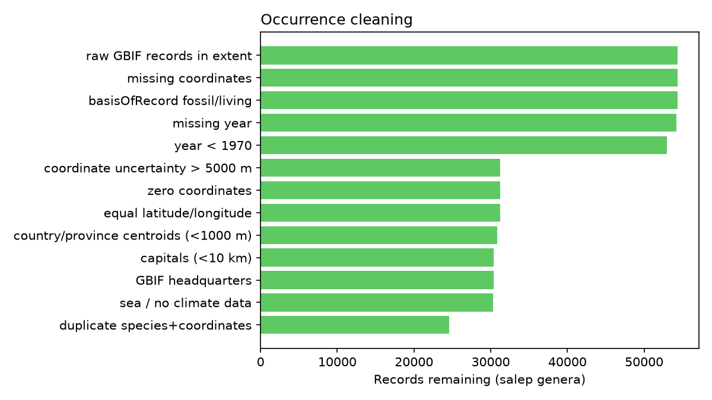

<!-- Slide 1 — Title -->
# SalepGuard
### Where are Turkey's salep orchids most exposed to tuber harvest, outside protected areas?

EthnoHack 2026 · Track 3: Biodiversity & Sustainability
Mehmet Eren Yaşar · Sena Aydın

Risk prioritisation, not observed harvest. Coarse (~9 km) by design.

---

<!-- Slide 2 — Problem -->
# Problem: a drink that kills the plant

- Salep (the hot drink, *salepli dondurma*, folk remedies) is made from **orchid tubers**
- About **90 species in 24 genera** are reported in Turkish salep (Sezik 2002)
- No commercial cultivation, so supply comes from **wild collection**, and each tuber is a dead plant
- The same pattern is reported in Greece (Kreziou et al. 2016) and Iran (Ghorbani et al. 2014)
- **Gap:** no open, spatial, uncertainty-aware tool says *where* to act

---

<!-- Slide 3 — Data -->
# Data: open and reproducible

| Layer | Source |
|---|---|
| 62k orchid records, E. Mediterranean | GBIF |
| Climate now + 2041–60 (3 GCMs × 2 SSPs) | WorldClim 2.1 / CMIP6 |
| Population, travel time | WorldPop 2020, Weiss et al. 2018 |
| Protected areas, provinces | OSM / WDPA, geoBoundaries |

65 % of Turkish records are obscured (~28 km) to protect orchids. We respect that and drop them.

---

<!-- Slide 4 — Method -->
# Method

1. Clean records (CoordinateCleaner logic) → **20 species**, target-group background
2. **Species distribution models**: bias-corrected MaxEnt, spatial block CV, bootstrap (+ Python baseline)
3. **Harvest-pressure proxy** = population + accessibility
4. **SalepGuard Priority Index**
   `Σ suitability × pressure × (1 − protected)`
5. Uncertainty propagation → **robust hotspots**; sensitivity (Jaccard); climate change; provinces; protection gap

---

<!-- Slide 5 — Prototype -->
# Prototype: interactive dashboard

Species explorer · Risk & priority (live sensitivity scenarios) · Province ranking · Protection gap · Methods
Live: https://salepguard.streamlit.app

---

<!-- Slide 6 — Results 1 -->
# Results: hotspots

- Hotspots are concentrated on the **Aegean, Marmara and eastern Mediterranean** coasts (İzmir, Aydın, Hatay, Marmara)
- 1,873 of 2,339 hotspot cells stay in the top 5 % even at the lower 95 % uncertainty bound

---

<!-- Slide 7 — Results 2 -->
# Results: the protection gap

- Only **4.4 %** of salep-orchid suitable area lies inside protected areas, the same as Turkey's average (4.4 %, OSM layer)
- Median species: **6.6 %** protected

Baseline model numbers; they will be updated with the final model.

---

<!-- Slide 8 — Impact -->
# Impact

- **Who:** Ministry of Agriculture & Forestry (DKMP), provincial directorates, NGOs, researchers
- **Use:** target monitoring and field surveys; prioritise new protection; plan **cultivation and
  certified-supply pilots** in high-pressure provinces
- **Livelihoods:** collectors rely on salep income. The goal is a sustainable supply, not a ban
- **Responsible display:** no raw points, ~9 km aggregation, explicit uncertainty

---

<!-- Slide 9 — Limitations -->
# Limitations (and why we still trust the ranking)

- Few usable Turkish records; **eastern Anatolia and *Dactylorhiza* are under-represented**
- Pressure is a **proxy**: urban cores score high
- OSM protected areas are incomplete; legal protection ≠ effective protection
- Genus-level salep attribution; climate projections hold pressure constant
- **Robustness:** hotspot Jaccard 0.88–0.89 across pressure weights; 0.66–0.70 binary vs continuous

---

<!-- Slide 10 — Team / next steps -->
# Team & next steps

**Mehmet Eren Yaşar**: data pipeline, risk index, dashboard
**Sena Aydın**: statistical modelling, validation, uncertainty

Next steps: herbarium data for eastern Turkey · trade/interview-based pressure · WDPA + national registry ·
field validation with local partners · cultivation-suitability module

github.com/mehmeterenyasar/salepguard · salepguard.streamlit.app
