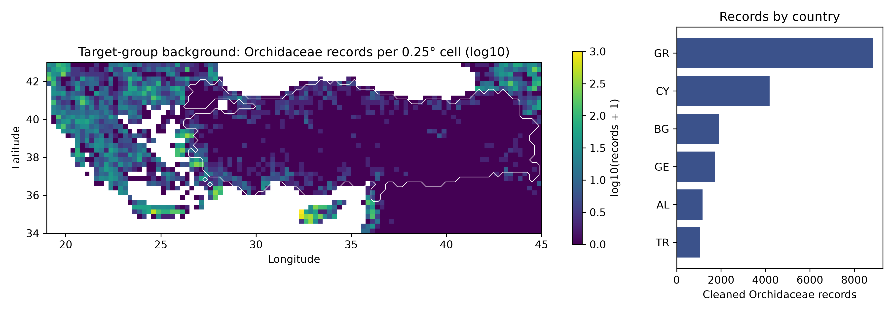
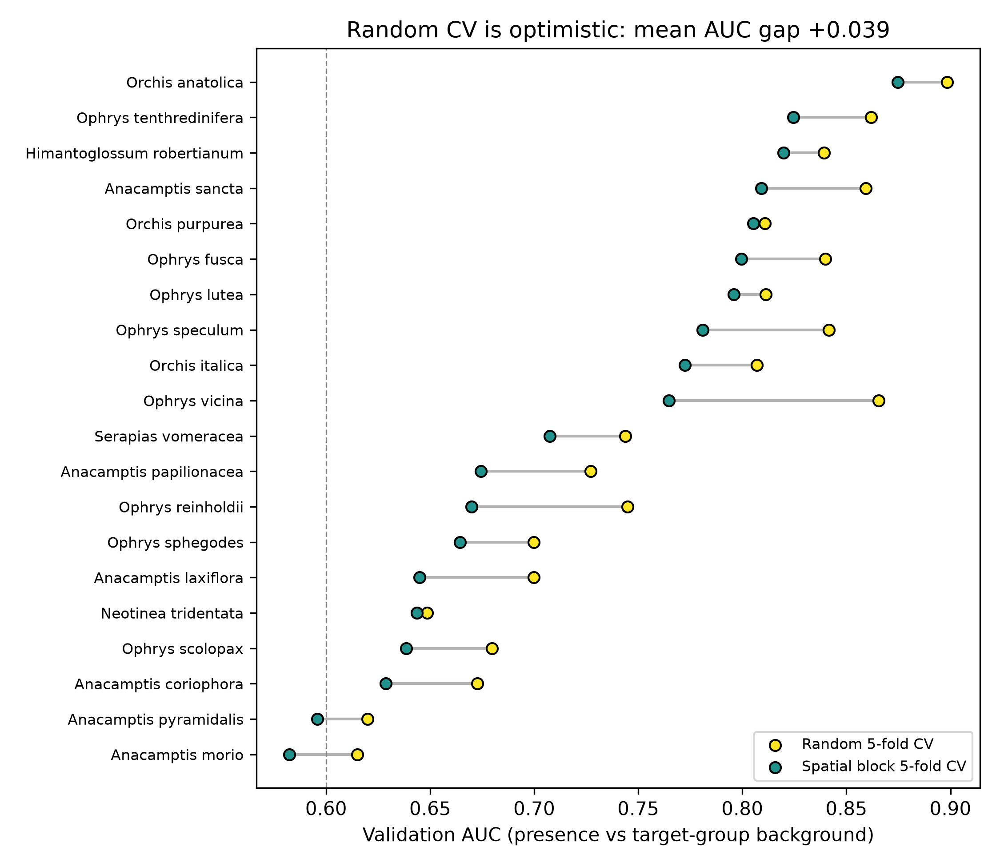
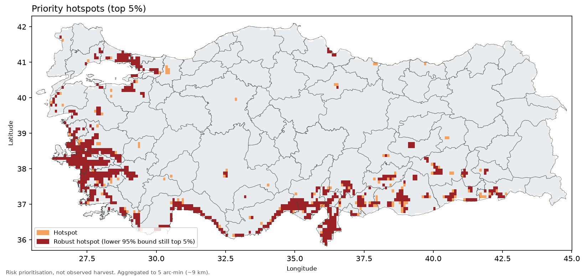
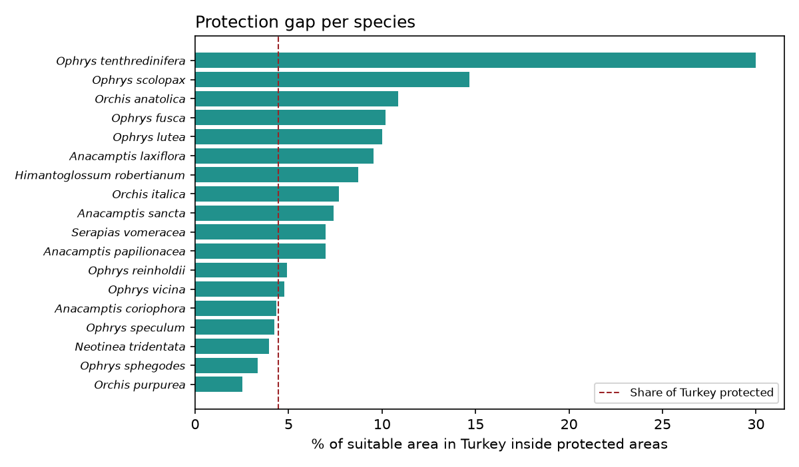
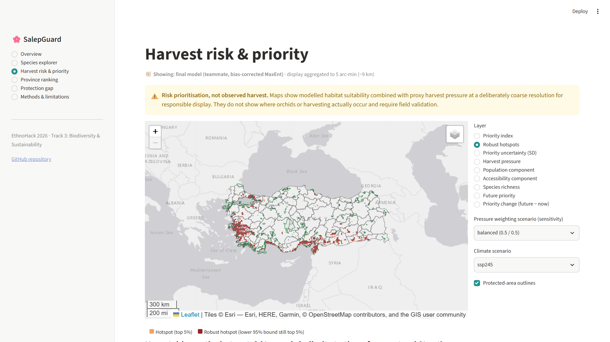

<!-- _class: title -->
<!-- Slide 1 — Title -->
# SalepGuard
### Where are Turkey's salep orchids most exposed to tuber harvest, outside protected areas?

EthnoHack 2026 · Track 3: Biodiversity & Sustainability
Mehmet Eren Yaşar · Sena Aydın

Risk prioritisation, not observed harvest. Coarse (~9 km) by design.

---

<!-- Slide 2 — Problem -->
# Problem: a drink that kills the plant

- Salep (the hot drink, *salepli dondurma*, folk remedies) is made from **orchid tubers**
- About **90 species in 24 genera** are reported in Turkish salep (Sezik 2002)
- No commercial cultivation, so supply comes from **wild collection**, and each tuber is a dead plant
- The same pattern is reported in Greece (Kreziou et al. 2016) and Iran (Ghorbani et al. 2014)
- **Gap:** no open, spatial, uncertainty-aware tool says *where* to act

---

<!-- Slide 3 — Data -->
# Data: open, reproducible, and biased

- **GBIF** (DOI): 62k orchid records, E. Mediterranean → 24,557 clean, **20 species**
- **WorldClim 2.1 / CMIP6**: climate now + 2041–60 (3 GCMs × 2 SSPs)
- **WorldPop 2020, Weiss et al. 2018**: population, travel time · **WDPA + OSM**, geoBoundaries
- ~65 % of Turkish records are blurred (~28 km) to protect orchids: we drop them

---

<!-- Slide 4 — Method -->
# Method

1. **Target-group background**: each species vs. all orchid records → "where recorders went" is cancelled out
2. **MaxEnt**, 6 non-redundant climate variables (|r| ≤ 0.65), complexity tuned per species
3. **Spatial block CV** (200 km blocks), 20 bootstraps, MESS for extrapolation, bias-aware null models
4. **Harvest-pressure proxy** = population + accessibility (50/50; 70/30 and 30/70 scenarios)
5. **SalepGuard Priority Index** = `Σ suitability × pressure × (1 − protected)`
6. Uncertainty propagated → **robust hotspots**; Jaccard sensitivity; climate change; provinces

---

<!-- Slide 5 — Model validation -->
# Models: honest validation

- Spatial AUC **0.72** (0.58–0.87), Boyce 0.58
- Random CV would claim 0.76: the gap is the optimism we removed
- All 20 species beat a bias-aware null model (p = 0.02)
- *A. morio* and *A. pyramidalis* (AUC < 0.6) are **excluded** from the index
- 2041–60, no dispersal: median species **−9 %** (SSP2-4.5) to **−14 %** (SSP5-8.5) of its Turkish range

---

<!-- Slide 6 — Hotspots -->
# Results: hotspots

- Aegean, Marmara and eastern Mediterranean coasts
- Top provinces: **Hatay, İzmir, Aydın, İstanbul, Gaziantep**
- **1,983 of 2,339** hotspot cells stay in the top 5 % even at the lower 95 % uncertainty bound
- Stable across pressure weights (Jaccard 0.87–0.88)

---

<!-- Slide 7 — Protection gap -->
# Results: the protection gap

- Only **4.5 %** of salep-orchid suitable area is protected
- That is **no more than Turkey's average** (4.5 %, WDPA + OSM)
- Median species: **7.2 %** protected

---

<!-- Slide 8 — Prototype -->
# Prototype: interactive dashboard

Species explorer · Risk & priority (live sensitivity scenarios) · Province ranking · Protection gap · Methods
**Live: https://salepguard.streamlit.app** · no raw points, ~9 km aggregation

---

<!-- Slide 9 — Limitations -->
# Limitations

- Not a map of harvest or of orchids: **every hotspot needs a field check**
- Few usable Turkish records; **eastern Anatolia and *Dactylorhiza* are under-represented** (unknown, not empty)
- Suitability is relative; background ≠ absence; 1970–2000 climate baseline
- Pressure is a **proxy** (urban cores score high); OSM protected areas are incomplete
- Future maps ignore fungi, pollinators and dispersal; 3 climate models only
- Binary vs continuous suitability changes hotspots more (Jaccard 0.60–0.64)

---

<!-- Slide 10 — Impact / team -->
# Impact, team & next steps

- **Who:** Ministry of Agriculture & Forestry (DKMP), provincial directorates, NGOs, researchers
- **Use:** target surveys, prioritise protection, pilot **cultivation and certified salep** with collectors
- **Next:** herbarium data for eastern Turkey · trade/interview-based pressure · national protected-area registry · field validation

**Mehmet Eren Yaşar**: data pipeline, risk index, dashboard · **Sena Aydın**: modelling, validation, uncertainty

github.com/mehmeterenyasar/salepguard · salepguard.streamlit.app
